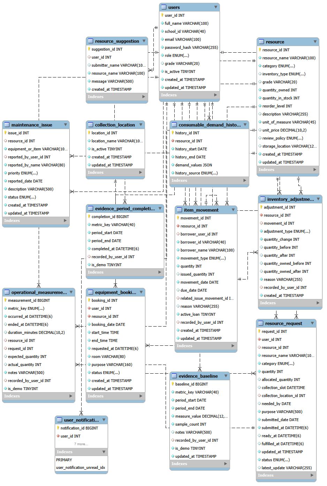

# Group 15 — LTSM Portal

## Project overview

The LTSM Portal is a web-based platform configured for Foundation Phase Grades 1–3. It aims to improve resource visibility, streamline bookings and requests, track inventory, and support management reporting.

The application uses Flask, a JSON API, and MySQL to manage inventory, requests, bookings, circulation and reporting.

## Project structure

```text
Group_15/
├── app.py                       # Flask application and API routes
├── blueprints.py                # Route groups by application domain
├── config.py                    # Development, testing and production settings
├── db.py                        # MySQL connection and query helpers
├── model.py                     # User authentication and account management
├── inventory_model_live.py      # Inventory demand and replenishment calculations
├── init_db.py                   # Database initialization and additive migrations
├── schema.sql                   # MySQL database schema
├── seed.sql                     # Sample data for a fresh database
├── requirements.txt             # Python dependencies
├── README.md                    # Setup, API and project documentation
├── Templates/                   # Flask/Jinja pages
│   ├── base.html                # Shared page layout and navigation
│   ├── index.html               # Public landing page
│   ├── login.html               # Sign-in page
│   ├── register.html            # Teacher/staff account registration
│   ├── ltsm-dashboard.html      # Committee dashboard
│   ├── user-dashboard.html      # Teacher/staff dashboard
│   ├── manage-inventory.html    # Inventory management
│   ├── manage-users.html        # Account management and approvals
│   ├── request-management.html  # Committee request workflow
│   ├── manage-bookings.html     # Equipment booking management
│   ├── issue-return.html        # Circulation and loan tracking
│   ├── maintenance.html         # Maintenance tracking
│   ├── reports.html             # Committee reports
│   └── ...                      # Other request, resource and report pages
├── static/
│   ├── css/                     # Shared stylesheets
│   ├── js/                      # API, authentication and page behavior
│   └── images/                  # Portal logo and inventory images
├── tests/                       # Python unit and API tests
├── docs/
│   ├── ERD.png                  # Database relationship diagram
│   └── RUNBOOK.md               # Backup, migration and recovery guidance
```

## Database ERD

The diagram below was reverse-engineered from the LTSM Portal database. Click it to open the full-size image.

[](./docs/ERD.png)

## Application architecture

The application is started from `app.py`. Routes are registered through domain Blueprints declared in [blueprints.py](./blueprints.py); environment-specific Flask settings are defined in [config.py](./config.py).

| Blueprint | Responsibility |
| --- | --- |
| `pages_bp` | HTML pages |
| `auth_bp` | Login, registration and user administration |
| `notifications_bp` | Notification history and actions |
| `catalog_bp` | Public resources, equipment and suggestions |
| `requests_bp` | Resource requests and collection locations |
| `bookings_bp` | Equipment bookings |
| `inventory_bp` | Inventory records and stock adjustments |
| `circulation_bp` | Loans, borrowers and movement history |
| `maintenance_bp` | Maintenance issues |
| `dashboard_bp` | User and committee dashboards |
| `evidence_bp` | Operational evidence and measurements |
| `reports_bp` | Committee reports |
| `health_bp` | Health check |

## Configuration

`APP_ENV` selects a profile in `config.py`; it defaults to `development`. The `test` and `testing` profiles enable Flask testing mode. `production` keeps debug disabled, enables secure session cookies, and requires `SECRET_KEY`. Database connection settings are read from `.env` by `db.py`; start from `.env.example` and do not commit secrets.

## API reference

Successful `/api` endpoints return JSON; controlled API errors also use JSON. Protected endpoints require a signed-in user; committee endpoints require the LTSM role. The notification list uses cursor pagination, and available list filters are noted in the table.

| Method | Path | Purpose |
| --- | --- | --- |
| GET | `/api/notifications` | List notifications, unread counts, and the next history cursor; filter by module. |
| POST | `/api/notifications/read` | Mark notifications in a module as read. |
| POST | `/api/notifications/<int:notification_id>/done` | Mark a notification as done. |
| POST | `/api/login` | Authenticate a staff or committee account. |
| POST | `/api/logout` | End the current session. |
| POST | `/api/register` | Submit a staff account request for LTSM approval. |
| GET | `/api/committee/users` | List accounts for committee administration. |
| POST | `/api/committee/users` | Create a staff or committee account. |
| POST | `/api/committee/users/<int:user_id>/approve` | Approve a pending staff account request. |
| POST | `/api/committee/users/<int:user_id>/status` | Activate or deactivate an account. |
| GET | `/api/resources` | Search the public resource catalogue by name or category. |
| POST | `/api/suggestions` | Submit a resource suggestion. |
| POST | `/api/requests` | Submit a resource request. |
| GET | `/api/requests` | List the signed-in user's requests; optionally filter by status. |
| GET | `/api/equipment` | List equipment available to book. |
| POST | `/api/bookings` | Request an equipment booking. |
| GET | `/api/bookings` | List the signed-in user's bookings. |
| GET | `/api/inventory` | List in-scope inventory; filter by name, category or inventory type. |
| POST | `/api/inventory` | Add an inventory item. |
| PUT | `/api/inventory/<int:item_id>` | Update an inventory item. |
| GET | `/api/inventory/adjustments` | List inventory adjustment history. |
| POST | `/api/inventory/adjust` | Receive, remove or write off stock. |
| GET | `/api/loans` | List current loans. |
| GET | `/api/borrowers` | List eligible borrowers. |
| GET | `/api/movement-history` | Search circulation movement history. |
| POST | `/api/movements` | Issue, return, or record lost or damaged items. |
| GET | `/api/maintenance` | List maintenance issues. |
| POST | `/api/maintenance` | Report a maintenance issue. |
| GET | `/api/committee/requests` | List all requests; optionally filter by status. |
| GET | `/api/collection-locations` | List active request collection locations. |
| GET | `/api/committee/suggestions` | List submitted resource suggestions. |
| POST | `/api/requests/<int:request_id>/decision` | Approve or decline a request and schedule collection. |
| POST | `/api/committee/requests/<int:request_id>/fulfill` | Fulfill an allocated request and record the stock movement. |
| GET | `/api/committee/bookings` | List committee bookings; optionally filter by status. |
| POST | `/api/bookings/<int:booking_id>/decision` | Confirm, decline or cancel a booking. |
| GET | `/api/dashboard/user` | Load the signed-in user's dashboard data. |
| GET | `/api/dashboard/committee` | Load committee dashboard data. |
| GET | `/api/dashboard/business-value` | Load ABC classification and inventory value data. |
| GET | `/api/evidence/automatic` | Compare automatically measured KPIs with an equal-length preceding period. |
| GET | `/api/evidence/trends` | Return daily points for a selected KPI line graph (`metric`, `from`, and `to` query parameters). |
| GET | `/api/evidence` | Legacy baseline/manual-evidence comparison; not used by the current Reports page. |
| POST | `/api/evidence/baseline` | Legacy endpoint for saving manual baselines; not used by the current Reports page. |
| POST | `/api/evidence/completion` | Legacy endpoint for marking manual evidence complete; not used by the current Reports page. |
| POST | `/api/evidence/measurements` | Legacy endpoint for manual operational measurements; not used by the current Reports page. |
| POST | `/api/evidence/downtime/<int:measurement_id>/restore` | Legacy endpoint for closing a manual outage record. |
| GET | `/api/evidence/open-downtime` | Legacy endpoint for listing manual outage records. |
| GET | `/api/reports` | Load the committee report summary. |
| GET | `/health` | Return application health and server time. |

## Technologies

- Flask and Python
- MySQL
- HTML, CSS, JavaScript and Jinja templates
- Git and GitHub
- Visual Studio Code

## Getting started

This is a full-stack Flask and MySQL application, not a front-end-only prototype. Flask renders the Jinja pages and provides the JSON API; MySQL stores application data. Do not open the templates with Live Server.

### Method 1: Sign in using the hosted portal

Open the [LTSM Portal](https://group-15-1.onrender.com/) and sign in with your account. New teacher/staff users can register there; an LTSM Committee Member must approve the request before sign-in. Use the credentials provided for the hosted service. Note : Chrome might throw an error when used to open the application please use microsoft edge in that instance. The password and login details are provided on clickup.

### Method 2: Run locally

Follow these steps to run Flask and MySQL on your own computer. Do not open the templates directly or use Live Server.

1. Install Git and Python, then clone the repository and enter its folder:

   ```
   git clone https://github.com/Brendon7777/Group_15.git
   cd Group_15
   ```

2. Create and activate a virtual environment, then install the dependencies:

   ```
   python -m venv .venv
   ```

   On Windows PowerShell:

   ```
   .\.venv\Scripts\Activate.ps1
   ```

   On macOS/Linux:

   ```
   source .venv/bin/activate
   ```

   Then install the requirements:

   ```
   python -m pip install -r requirements.txt
   ```

3. Configure the database connection. For shared testing, each tester running Flask on their own computer needs the Aiven connection settings in a local `.env` file. Copy `.env.example` to `.env` (`Copy-Item .env.example .env` in PowerShell, or `cp .env.example .env` on macOS/Linux), then set `DB_HOST`, `DB_PORT`, `DB_USER`, `DB_PASSWORD`, and `DB_NAME` to the values for the shared **test** database in Aiven. Set `DB_SSL=required`; set `DB_SSL_CA` to the downloaded Aiven CA certificate path if your service requires it.

   The project owner must provide the connection settings to testers privately; never commit `.env` or send database passwords through GitHub. Each tester's public IP must also be allowed by the Aiven service's IP access controls. Since all testers use the same database, their changes are shared. Use a dedicated test database and do not point testers at a production database. If you do not want to distribute database credentials or allow tester IPs, host Flask once and give testers the app URL instead.

4. Initialize the shared database **once**, not once per tester. The database owner should run this only for a new test database or when a project update requires database migrations. It creates missing tables, applies migrations, and may load demo data; never use `--reset` on a shared database.

   ```
   python init_db.py
   ```

5. Start the app on each tester's computer:

   ```
   python app.py   or flask run
   ```

   Open http://127.0.0.1:5000. Each tester's local app will read and write the same Aiven database. On a freshly initialized test database, the initializer seeds these demo accounts; the password for both is `Password123!`:

| Role | Username |
| --- | --- |
| Teacher | g2.teacher1@example.com |
| LTSM Committee Member | ltsm01@example.com |

### Sample accounts and account access

**For the lecturer testing the committee/admin features:** sign in with the **LTSM Committee Member** account in the table above (`ltsm01@example.com`). It is seeded by `python init_db.py` and already has access to LTSM pages, including account management. You do not need to create a separate admin account for the lecturer.

**For a teacher/staff account:** on the sign-in page, select **Create one** and submit the account details with a password of at least 8 characters. The registration is a pending account request; an LTSM Committee Member must approve it before the user can sign in with the registered email or staff number and password. Registration does not grant LTSM/admin access.

If the database owner initialized the database before this login was corrected, the owner can run `python init_db.py` again from an authorized environment. It updates the old seeded demo password hash without resetting the database or changing passwords that have already been changed; testers should not run the initializer unless the owner asks them to.

If you want to test a different LTSM account, sign in with the seeded LTSM account, open `manage-users.html`, and create an account with the **LTSM Committee Member** role. Keep the listed demo credentials for coursework testing only; do not use them for a public deployment. The application stores password hashes rather than plain-text passwords.

### Database initialization and data

`python init_db.py` creates the configured database if needed, creates missing tables, applies additive migrations, and loads sample data only when the resource table is empty. The seed includes illustrative records for every schema table. Operational measurements, baselines, and period completions are marked as demo data and excluded from live evidence calculations. Set `DB_SSL=required` when connecting to a MySQL server that requires TLS. Registration and login use the MySQL `users` table. Only teachers/staff and LTSM Committee Members can sign in; existing learner accounts are blocked from sign-in, while active learner records remain available as circulation recipients. LTSM Committee Members can manage accounts at `manage-users.html`; deactivation blocks sign-in while retaining account history. Do not use `python init_db.py --reset` unless you intend to drop the project tables and their data.

### Resource catalogue and core workflows

Teacher/staff and LTSM dashboards and management pages read and write resources, requests, bookings, loans, and maintenance issues through MySQL. The public resource catalogue and LTSM inventory listing show textbooks for Foundation Phase Grades 1–3; older database records are retained but hidden. New textbook records require a Grade 1, 2, or 3 selection, and free-text textbook requests must identify one of those grades. The catalogue is available at `view-resources.html` and `resource.html`; it displays item photos matched by resource name with a category-photo fallback, and the same photos appear in the LTSM inventory catalogue. Equipment can be booked directly from its catalogue row, while the main `request-resources.html` page is the hub for requesting items and opening the equipment booking flow. LTSM Committee Members can review all past and upcoming equipment reservations, filter them by status, approve or decline pending bookings, cancel confirmed future bookings, and view day, week, or month calendars at `manage-bookings.html`; overlapping bookings are limited to the currently available equipment quantity and are checked again when confirming. The LTSM dashboard retains a compact upcoming-bookings panel with a link to the full booking list. Anyone can submit a resource suggestion at `suggest-resource.html`, anonymously or with a name; LTSM Committee Members review suggestions in the inventory page. LTSM account management uses the `users` table. LTSM request decisions are managed at `request-management.html`: the committee checks current available stock, allocates and reserves the full requested quantity, and schedules a collection slot before marking a request ready. Marking it fulfilled records an issue in the circulation history and deducts stock; the issued items then appear in `issue-return.html` for a later return. Declined, pending, ready, and fulfilled requests are filterable on the management page, while requesters can track collection details and status on `my-requests.html`. On `manage-inventory.html`, LTSM Committee Members can add and edit inventory records, set descriptions, units and storage locations, and categorize resources as textbooks, stationery, consumables, equipment or other. Receive stock increases available and owned quantities; removals and damaged, lost or obsolete write-offs reduce available stock and are recorded with a reason, actor and timestamp. Stock allocated to requests is excluded from availability and protected from manual removal and other issues. The page shows the latest 100 audit records, including received stock, write-offs and issue/return movements. The LTSM-only inventory forecast is at `inventory-summary.html`; it reads current stock and prices from `resource` and demand history from `consumable_demand_history`, and does not place orders or modify stock. Valid resources are still forecast when another resource has missing or malformed history; the summary lists the affected records and required corrections. Each six-month resource needs six monthly demand values over six complete months, and each annual resource needs three annual values over 36 complete months. History is tagged as recorded, illustrative, or unverified; illustrative seed figures are identified in the forecast and must not be treated as actual usage. Six-month stock warnings compare against expected demand during lead time, while annual warnings compare stock against the next annual issue and safety buffer. The initializer migrates inventory locations and request-allocation fields, adds the Fulfilled status, links existing requests to matching inventory items, corrects recognized sample data, and backfills existing issue/return movements into the audit table without resetting the database.

### Request queue and booking rules

Resource requests display their submission timestamp in the LTSM management queue, oldest first. Approvals are enforced first-come, first-served per inventory item; an earlier pending request must be decided before a later request can be approved. The database initializer adds `submitted_at` to existing installations; older requests use their original submission date with request ID as the tie-breaker because their exact historical time is unavailable.

#### Booking overlap prevention

Equipment bookings require a 20-minute gap between uses of the same item. The buffer is checked both when a booking is requested and again when the committee confirms it, including bookings on adjacent dates.
The booking form shows each equipment item's available count and recorded storage location, if set; the room field records where the requester will use it.

### Inventory classification and forecasts

Inventory keeps its detailed category (such as Textbooks or Equipment) and has a separate Consumable/Non-consumable type. The inventory add/edit forms do not offer a Consumables category; consumable classification remains available through the separate inventory type field. The additive migration suggests a type for known categories; existing `Other` items remain unclassified until an LTSM member edits them. Enter unit prices on the inventory page for monetary totals. The LTSM dashboard ABC dropdown lets staff switch between value and annual usage. Value mode retains annual usage value for consumables and on-hand value for non-consumables. Annual-usage mode uses forecast annual quantities for consumables and recorded issues in the previous 12 months for reusable items. Each item type is classified separately; items without the required type, price, or usable history remain unclassified rather than receiving guessed values.

### Audit history and reporting

The core resource, request, booking, and movement records have `created_at` and `updated_at` audit timestamps. Circulation movements retain borrower ID/name snapshots and also reference `users` through `borrower_user_id`; older unmatched borrower snapshots are preserved with a null user reference.

The LTSM login dashboard keeps an item-by-item ABC classification dropdown. The Reports page includes measures that help staff investigate the seven Lean wastes; these indicators do not prove the portal eliminated them.

#### Automatic reporting

The LTSM Reports page automatically compares request counts, request readiness and fulfillment times, booking counts, and booking conflict rates with the immediately preceding period of equal length. Request intervals start at submission or ready status and stop when the next status is recorded; incomplete intervals are excluded. “View line graph” shows daily values calculated from timestamped request and booking records in the selected period. No manual before/after figures or manual measurement completion steps are required. Measures that need staff observations (such as avoidable trips, physical-count accuracy, report preparation, or equipment downtime) are intentionally not presented as automatic KPIs. Historical baseline and manual-measurement records are preserved but are not used by this automatic comparison. The former evidence API routes remain available for compatibility with older clients; the current Reports page does not call them.

#### Dashboard customization

Both dashboards include a `Rearrange tiles` mode. Tiles can be dragged or moved with the arrow keys; each account's layout is saved in that browser and can be reset from the dashboard.

### Notifications and collection locations

#### Email response notifications

- Copy `.env.example` to `.env` and configure `SMTP_HOST`, `SMTP_PORT`, `SMTP_USERNAME`, `SMTP_PASSWORD`, `SMTP_FROM`, and, if needed, `SMTP_USE_TLS` or `SMTP_USE_SSL`.
- After an LTSM member approves or declines a resource request, fulfills a request, or confirms/declines/cancels a booking, the requester receives an email at the address stored on their account.
- Email delivery is best-effort: if SMTP is not configured or delivery fails, the portal notification and database status still complete successfully.

#### In-app notifications

The shared navigation displays persistent unread notification badges for LTSM members when new resource requests arrive, and for requesters when resource requests or equipment bookings are approved, declined, or cancelled. Each relevant module shows notifications 20 at a time with a Load more action. Notifications can be marked Done without deleting their history; opening the module marks them as read. Notification writes are committed with the request or booking decision. Run `python init_db.py` to add the nullable `done_at` field to an existing notification table; this preserves notification history.

#### Collection points

Request collection points are stored separately from inventory storage locations. LTSM selects an active point when approving a request; the chosen point and scheduled time are saved with that request and included in the requester’s status update and approval notification. The initializer adds the collection-location table and nullable request link without resetting existing data, and seeds “Storage Room 01” and “Printer Room 34” as initial options.

### Circulation and returns

The LTSM circulation desk at `issue-return.html` issues resources to active, registered teachers/staff and can retain active learner accounts as borrower records even though learners cannot sign in. Each issue records its original quantity, recipient, issue date, expected return date and recording staff member. Returns and lost/damaged reports are appended as separate events linked to the exact issue; outstanding quantities are calculated from those events, and the recent history can be searched by borrower or item. Return events restore available stock, while lost/damaged events reduce the owned quantity and appear in the inventory audit trail. The initializer adds the tracking fields without resetting existing data; existing active loan quantities are preserved as their migration-time outstanding balance, while new events receive exact issue links.

## Tests and operations

- Run all tests: `python -m unittest discover -s tests -v`.
- Copy `.env.example` to `.env` and configure the required database settings.
- MySQL backup, restore, failed-migration recovery, deployment, health check, and troubleshooting: [docs/RUNBOOK.md](./docs/RUNBOOK.md).
- The Reports page compares automatic portal measures against the prior equal-length period. Line-chart values are daily aggregates from timestamped records; days with no events are omitted rather than treated as zero.

## Team and contributions

| Group member | Student number | Contributions |
| --- | --- | --- |
| Brendon Sithole | 23547309 | Focused on backend development and deployment; contributed to the report and PowerPoint video with the group. |
| Tebogo Napyane | 20553596 | Focused on backend development and deployment; contributed to the report and PowerPoint video with the group. |
| Phiwayinkhosi Nxumalo (Phiwa) | 22780450 | Focused on microflows and contributed to frontend development; contributed to the report and PowerPoint video with the group. |
| Kimberleigh Hartley (Kim) | 19008423 | Focused on microflows and contributed to frontend development; contributed to the report and PowerPoint video with the group. |
| Copilot | - | Used to organize the readme|
